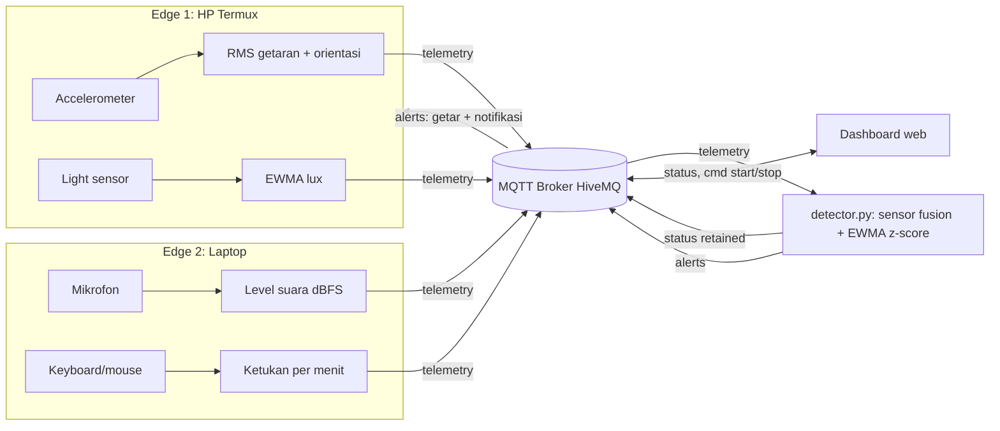

# Arsitektur FocusNest

Empat kotak cara kerja IoT (sesuai materi kuliah):

| Kotak | Di proyek ini |
|---|---|
| Sensor + Edge | **Edge 1** HP Android (accelerometer + light, Python di Termux) dan **Edge 2** laptop (mikrofon + aktivitas keyboard/mouse) |
| Jaringan | WiFi / hotspot yang sama |
| Cloud | Broker MQTT publik HiveMQ (`broker.hivemq.com`, TLS port 8883) |
| Dashboard | Web di laptop (`detector.py` menyajikan `dashboard/index.html`), bisa dibuka dari HP di jaringan yang sama |



## Topic MQTT

Semua topic diawali `focusnest/<PROJECT_ID>/`.

| Topic | Arah | Isi |
|---|---|---|
| `edge/edge1/telemetry` | HP -> cloud | `motion_rms`, `orientation`, `lux` |
| `edge/edge2/telemetry` | laptop -> cloud | `noise_dbfs`, `keys_per_min`, `mouse_moves` |
| `edge/<id>/online` | edge -> cloud (retained, LWT) | `1` / `0` |
| `status` | detector -> HP + dashboard (retained) | state, skor, skor per sensor, statistik sesi |
| `alerts` | detector -> HP | jenis dan pesan gangguan |
| `cmd` | dashboard -> detector | `{"action":"start"}` / `{"action":"stop"}` |

Contoh payload `edge1/telemetry`:

```json
{"device_id":"edge1","sequence":42,"sent_at_ms":1793275032000,"motion_rms":0.031,"orientation":"face_down","lux":null,"samples":20}
```

## Pengolahan data dan algoritma

| Lokasi | Pengolahan | Rumus |
|---|---|---|
| HP | 1. RMS getaran | `m = sqrt(x²+y²+z²) - 9,81`; `rms = sqrt(mean(m²))` |
| HP | 2. Klasifikasi orientasi | rata-rata z <= -6 telungkup, >= 6 telentang |
| HP | 3. Penghalusan cahaya | `lux_s = 0,3 lux + 0,7 lux_s_lama` (EWMA) |
| Laptop | 4. Level suara | `dBFS = 20 log10(rms audio)` |
| Laptop | 5. Laju mengetik | ketukan per jendela x 60 / panjang jendela |
| Detector | Sensor fusion berbobot | `skor = 0,30 suara + 0,20 cahaya + 0,35 HP + 0,15 aktivitas` (sensor tidak valid dilewati, bobot dinormalkan) |
| Detector | Deteksi anomali | z-score EWMA pada kenaikan suara; lonjakan jika `z > 3` dan `>= 10 dB` |
| Detector | Aturan keputusan | HP bergerak >= 2 jendela dan laptop sepi -> `PHONE_DISTRACTION` |

Sensor cahaya ada di depan HP, jadi saat HP telungkup nilainya tidak valid dan diabaikan.
